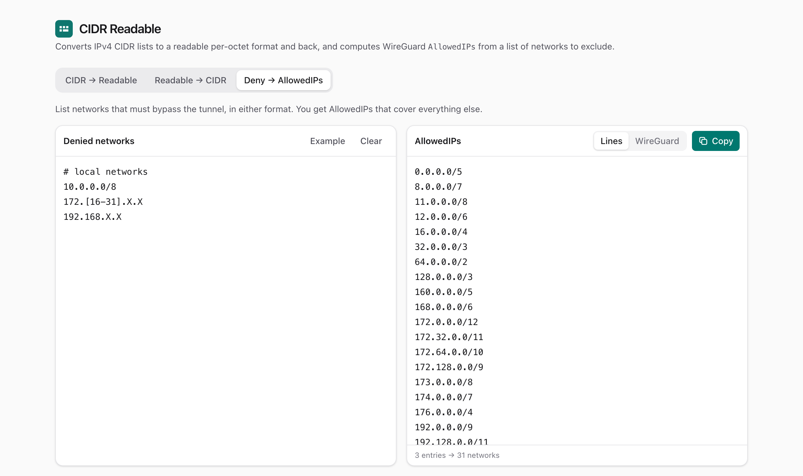

# CIDR Readable

[](https://github.com/vedmaque/cidr-readable/actions/workflows/ci.yml)
[](https://github.com/vedmaque/cidr-readable/actions/workflows/deploy.yml)
[](LICENSE)

A web app that converts IPv4 CIDR lists to a readable per-octet format and back, and computes
WireGuard `AllowedIPs` from a list of networks to exclude.

App: https://vedmaque.github.io/cidr-readable/

<picture>
  <source media="(prefers-color-scheme: dark)" srcset="docs/screenshot-dark.png" />
  
</picture>

## Modes

- **CIDR → Readable**: `172.16.0.0/12` → `172.[16-31].X.X`.
- **Readable → CIDR**: readable patterns → the minimal list of CIDR blocks.
- **Deny → AllowedIPs**: the CIDR blocks that cover the whole IPv4 space except the given
  networks.

Input entries are separated by newlines or commas, so a line copied from a WireGuard config
(`AllowedIPs = …`) works as is. Both formats can be mixed; `# comments` are ignored. Output is
sorted, with duplicates removed and overlapping or adjacent networks merged. CIDR output is one
entry per line by default, or a single comma-separated line for WireGuard. Invalid entries are
listed with their line numbers; the valid ones are still converted.

## Readable format

Four dot-separated octets. Each octet is a number (`10`), an inclusive range (`[16-31]`) or `X`
(any value). Once an `X` appears, the remaining octets must be `X` too.

| CIDR             | Readable          |
| ---------------- | ----------------- |
| `172.16.0.0/12`  | `172.[16-31].X.X` |
| `10.0.0.0/8`     | `10.X.X.X`        |
| `192.168.4.0/22` | `192.168.[4-7].X` |
| `1.1.1.1/32`     | `1.1.1.1`         |

Ranges in several octets are allowed (`10.[1-2].[5-6].X` is the cartesian product). Only IPv4 is
supported.

## Development

Stack: Vue 3, TypeScript, Vite, Tailwind CSS, Vitest, Playwright.
Requires Node 24 and pnpm (version pinned in `package.json`).

```sh
pnpm install
pnpm dev             # dev server at http://localhost:5173
pnpm build           # type-check + production build
pnpm lint            # oxlint + eslint
pnpm format          # prettier
pnpm test:unit       # vitest
pnpm test:coverage   # vitest with coverage (100% required for src/domain)
pnpm test:e2e        # playwright (run `pnpm exec playwright install chromium` once)
```

A pre-commit hook (husky + lint-staged) lints and formats staged files. GUI git clients
(Fork, GitHub Desktop, …) don't load your shell profile, so if you use a Node version manager,
put its setup in `~/.config/husky/init.sh`; husky sources that file before every hook.

## Project structure

```
src/
  domain/ip/          Framework-free core: parsing, interval math, CIDR and readable formats
  features/converter/ Converter screen: mode definitions, useConverter composable, panels
  components/         Shared UI (buttons, segmented control, copy) and layout
  router/             Hash-based routes, one per mode
e2e/                  Playwright tests
```

All conversions go through one canonical model: every entry becomes a set of inclusive address
intervals, which are merged and then rendered into the requested format.

## Deployment

`.github/workflows/ci.yml` runs lint, formatting, type-check, unit and e2e tests. When CI passes
on `main`, `.github/workflows/deploy.yml` builds with `BASE_PATH=/<repo>/` and publishes to
GitHub Pages (enable Pages with **Source: GitHub Actions** in the repository settings).

## License

[MIT](LICENSE) © vedmaque
